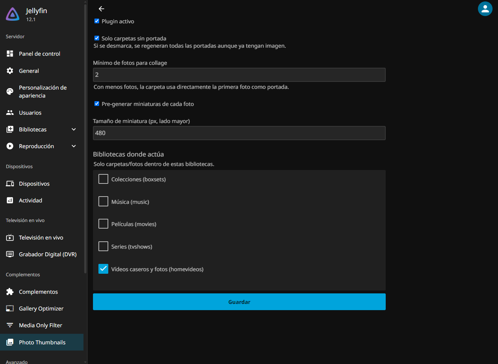

# Jellyfin.Plugin.PhotoThumbs

Plugin para **Jellyfin** que mejora la previsualización de las carpetas de
fotos: genera **portadas (collages)** para las carpetas que contienen fotos y
**pre-genera miniaturas** de cada imagen para que la galería cargue al
instante.

## El problema

En una biblioteca de tipo "Vídeos caseros y fotos", Jellyfin muestra las
carpetas con un icono genérico de carpeta en lugar de una vista previa del
contenido, y las miniaturas de cada foto se generan bajo demanda (lento la
primera vez, especialmente con fotos de móvil de muchos megapíxeles).



## Qué hace

### Portadas de carpetas (automático tras cada escaneo)

Implementa `ILibraryPostScanTask`: después de cada escaneo de biblioteca,
recorre las carpetas (`Folder`/`PhotoAlbum`) de las bibliotecas
seleccionadas que contienen fotos y les asigna imagen principal:

- Con **≥ N fotos** (configurable, def. 2) → genera un **collage 600×600**
  de hasta 4 fotos usando `IImageProcessor.CreateImageCollage` — el mismo
  motor que Jellyfin usa para los covers de álbumes/géneros. Se guarda en
  `<datadir>/data/photocovers/`.
- Con **menos fotos** → usa directamente la primera foto como portada.
- Se asigna con `SetImagePath` + `ItemUpdateType.ImageUpdate`, igual que una
  portada nativa.
- Con "Solo carpetas sin portada" activado, no pisa portadas existentes
  (propias o importadas por proveedores como Studio Images).

### Pre-generación de miniaturas (tarea programada)

"Generar portadas y miniaturas de fotos" — en **Panel → Tareas programadas**
— hace lo mismo que el post-scan **y además** pre-genera en caché la
miniatura Primary de cada foto al tamaño configurado (`ThumbSize`,
def. 480 px de lado mayor, calidad 85, con auto-orientación EXIF).

Así, al abrir la galería las miniaturas ya están en
`cache/images/resized-images` y la vista carga de inmediato.

Ambas funciones actúan **solo dentro de las bibliotecas marcadas** en la
configuración (resueltas por sus rutas físicas). Lista vacía = el plugin no
hace nada.

## Configuración

En **Panel → Plugins → Photo Thumbnails**:

| Opción | Por defecto | Descripción |
|---|---|---|
| Plugin activo | ✅ | Activa/desactiva el plugin. |
| Solo carpetas sin portada | ✅ | Si se desmarca, se regeneran todas las portadas. |
| Mínimo de fotos para collage | `2` | Por debajo, la carpeta usa la primera foto como portada. |
| Pre-generar miniaturas de cada foto | ✅ | La tarea programada también llena la caché de miniaturas. |
| Tamaño de miniatura (px) | `480` | Lado mayor de la miniatura pre-generada. |
| Bibliotecas donde actúa | *(ninguna)* | Solo carpetas/fotos dentro de estas bibliotecas. |

## Uso

1. Marca la biblioteca de fotos en la configuración y guarda.
2. Ejecuta **Panel → Tareas programadas → "Generar portadas y miniaturas de
   fotos"** una vez para poblar portadas y caché.
3. A partir de ahí, cada escaneo de biblioteca regenera las portadas que
   falten automáticamente.

## Instalación

### Opción A — Repositorio de plugins (recomendada)

1. **Panel → Plugins → Repositories → +** y añade:
   `https://nen155.github.io/jellyfin-plugins-repo/manifest.json`
2. Instala **Photo Thumbnails** desde el catálogo y reinicia Jellyfin.

### Opción B — Manual

1. Detén Jellyfin.
2. Crea `<directorio de datos>\plugins\PhotoThumbs\`
   (Windows portable: `D:\Jellyfin\Data\plugins\PhotoThumbs\`;
   instalador: `%ProgramData%\Jellyfin\Server\plugins\PhotoThumbs\`;
   Docker: `<config>/plugins/PhotoThumbs/`).
3. Copia dentro `Jellyfin.Plugin.PhotoThumbs.dll` y reinicia.

## Notas

- Las fotos elegidas para el collage son las **más antiguas primero**
  (orden por fecha de creación), así la portada es estable entre escaneos.
- Si una carpeta ya tenía portada asignada por otro proveedor de imágenes,
  se respeta mientras "Solo carpetas sin portada" esté marcado.
- Los collages generados viven en el directorio de datos del servidor, no en
  tus carpetas de fotos — no se escribe nada junto a tu media.

## Compilación

Requiere **.NET SDK 10**:

```powershell
dotnet publish -c Release
```

El ensamblado queda en
`bin\Release\net10.0\publish\Jellyfin.Plugin.PhotoThumbs.dll`.

## Compatibilidad

- Compilado contra **Jellyfin 12.1** (`net10.0`; `targetAbi: 12.1.0.0`).

## Licencia

[GPL-2.0](LICENSE)
